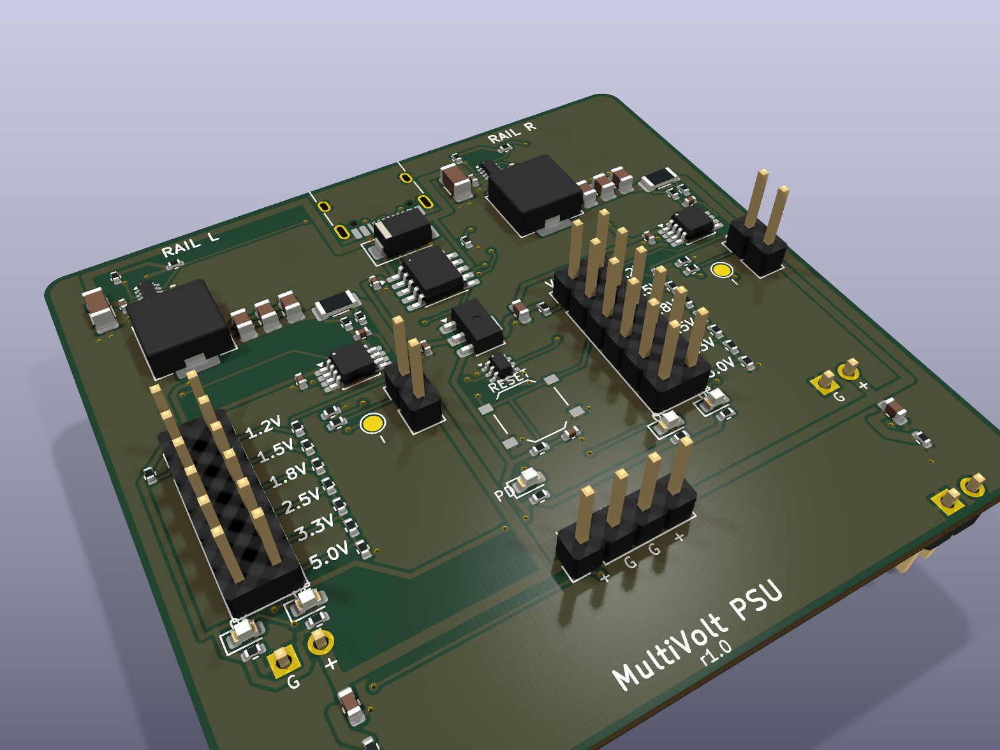
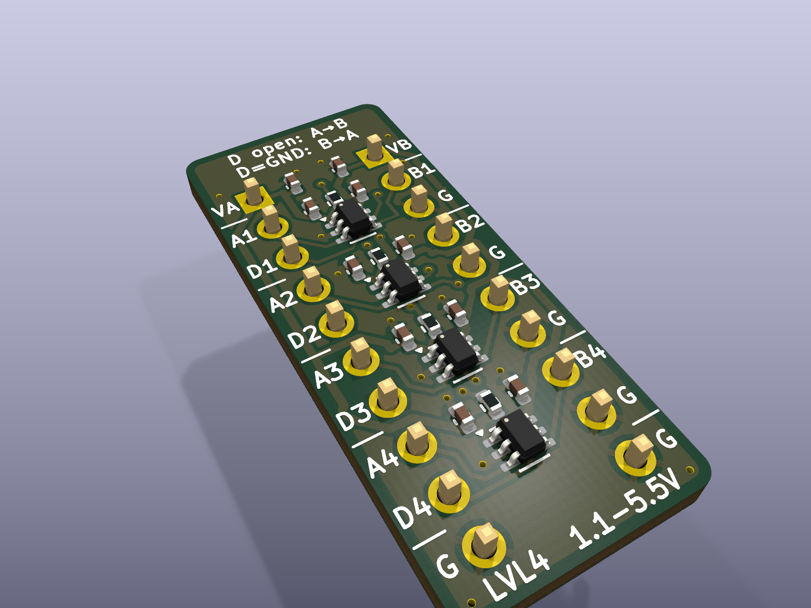

# MultiVolt — breadboard power & level-translation boards

Two KiCad 10 boards, designed for JLCPCB assembly:

| Board | What it is | Size | Parts cost* |
|---|---|---|---|
| **MultiVolt PSU** (`boards/mvpsu`) | USB-C PD supply that plugs into both breadboard power-rail pairs. Each side gets its own voltage, picked with a jumper: **1.2 / 1.5 / 1.8 / 2.5 / 3.3 / 5.0 V**. Latching overcurrent protection with LEDs. | 60 × 57 mm | ≈ $6.9 |
| **MultiVolt LVL4** (`boards/lvl4`) | 4-channel fixed-direction level translator, DIP-20 footprint (straddles the centre channel). | 12.7 × 28 mm | ≈ $1.35 |

\*Parts only, JLCPCB prices at qty 50/100, October 2026. Extended-part setup fees, PCB and assembly cost come on top.





### Repository layout
```
designs/       board descriptions (Python) - edit these, not the KiCad files
  psu.py         MultiVolt PSU
  iomodule.py    MultiVolt LVL4
lib/           custom KiCad symbol (INA301)
tools/         generator: schematic writer, PCB builder, autoroute, JLC export, BOM checker
boards/<name>/ generated KiCad 10 project (.kicad_sch/.kicad_pcb/.kicad_pro)
  fab/           gerbers zip, JLC BOM + CPL, schematic PDF, 3D renders
```

---

## MultiVolt PSU

### How it works
* **Input:** USB-C. A **CH224A** asks the charger for **9 V** over USB PD. If the charger can't do PD, the board still runs from 5 V, but the 5 V setting then gives about 4.8 V.
* **Two rails (L / R), each a TPS62933P synchronous buck** (3 A part, 500 kHz). Usable output is **up to 2 A per rail**, set by the protection.
* **Voltage select:** a 2×6 header per rail. Each row is one voltage; put a single jumper across the row you want.
  * **No jumper = rail off (≈0 V).** The FB pin is pulled to 3.3 V through 1 MΩ, so the converter just idles.
  * Two jumpers by mistake: the output lands *between* the two choices, never above the higher one.
  * Computed outputs: 1.202 / 1.500 / 1.800 / 2.501 / 3.296 / 4.992 V nominal, within about ±2 % worst case (see `tools/fb_string.py`).
  * Feedback is taken *after* the current shunt, so the shunt's voltage drop doesn't lower the output.
* **Protection:** an **INA301** watches a 50 mΩ shunt on each rail. Over the limit, it latches, pulls the buck's EN low and lights the **red OC LED**.
  * **ILIM jumper fitted = 1 A trip, removed = 2 A.**
  * Press **RESET** to re-arm both rails.
  * A ~94 µs filter stops normal capacitor inrush from tripping it. Short-circuit current is still limited cycle by cycle inside the TPS62933.
* **LEDs:**
  * **PD** (yellow): the PD contract was negotiated.
  * **OK** (yellow-green, one per rail): the converter reports power-good.
  * **OC** (red, one per rail): overcurrent latched.
* **Outputs:** the rail pins plug into both breadboard power-rail pairs (GND, + on each side). There's also a 4-pin **AUX** header (L+, G, G, R+) for wiring off-board.
* A 1 kΩ bleeder on each rail drops the old voltage in about 35 ms after you switch to a lower setting. The buck can't pull its output down by itself.

### Breadboard rail pins
Sized for MB102-style 830-point breadboards, 55–56 mm wide, with everything on the 0.1″ grid.

* **Positions:** the inner rail holes are 0.85″ (21.59 mm) from the centreline and the outer ones 0.95″ (24.13 mm).
* **Pins:** each side has **two 2-pin headers, 5 holes (12.7 mm) apart** along the rail, so the board sits firmly.
* **Polarity:** the order is **GND, +** on both sides, reading left to right with the USB connector facing away from the breadboard. To flip it to + then GND, set `RAIL_ORDER = "+G"` in `designs/psu.py` and regenerate.
* **Mounting:** the headers go on the **bottom** side, pins pointing down.

### Usage notes
* Choose the voltage **before** connecting sensitive parts. Changing the jumper on a live, loaded rail can trip OC: press RESET.
* The OK LED stays off with no jumper. That's expected.
* Inrush: about 46 µF across VBUS. PD chargers are fine with this, but it's above the old USB 2.0 limit of 10 µF.

---

## MultiVolt LVL4 (level translator)

Four **SN74LXC1T45** channels. Each side runs from its own supply, **1.1–5.5 V**, up to 420 Mbps. There's **no automatic direction sensing**: each channel's direction is set by its DIR pin.

* **Input threshold** follows the supply of the *input* side. The **output** swings to the supply of the *output* side.
* **DIRn high or unconnected** (100 k pull-up to VA) = **A → B**. **DIRn tied to GND** = **B → A**. DIR is referenced to **VA**.
* Push-pull only. **Not suitable for I²C or other open-drain buses.**

```
          ┌──────── LVL4 ────────┐
   VA   1 │●                     │ 1  VB
   A1   2 │                      │ 2  B1
   DIR1 3 │                      │ 3  GND
   A2   4 │                      │ 4  B2
   DIR2 5 │                      │ 5  GND
   A3   6 │                      │ 6  B3
   DIR3 7 │                      │ 7  GND
   A4   8 │                      │ 8  B4
   DIR4 9 │                      │ 9  GND
   GND 10 │                      │ 10 GND
          └──────────────────────┘   rows 0.3" apart (DIP-20)
```
Typical setup: VA and VB come from the two PSU rails, for example the L rail at 1.8 V and the R rail at 3.3 V.

---

## Ordering at JLCPCB
Upload these files from `boards/<name>/fab/`:
* `<name>_gerbers.zip`
* `<name>_bom_jlc.csv`
* `<name>_cpl_jlc.csv`

Board settings: 2 layers, 1.6 mm, any finish.

* **Check part rotations in JLC's placement preview before paying.** KiCad and LCSC sometimes disagree on which way a package faces. Fixes go in `ROT_FIX` in `tools/jlc_files.py`.
* The pin headers are through-hole parts. Use JLC's THT assembly option or solder them yourself. On both boards the breadboard headers mount on the **bottom** side.
* Jumper shunts aren't in the BOM: 3 per PSU (2× VSEL, 2× ILIM if you want 1 A). Standard 2.54 mm shunts, e.g. LCSC C100114.
* Rules used: 0.15 mm clearance, 0.10 mm minimum trace (only at fine-pitch pads), 0.3 mm vias. All within JLC's standard 2-layer process.

## Regenerating
Everything is generated from Python. Edit `designs/*.py`, then run:
```sh
tools/make_board.sh designs/psu.py mvpsu --passes 40      # schematic, ERC, netlist check, PCB, autoroute, DRC
tools/make_board.sh designs/iomodule.py lvl4 --passes 25
tools/fab.sh mvpsu && tools/fab.sh lvl4                     # gerbers, BOM, CPL, PDF, renders
python3 tools/check_bom.py boards/mvpsu/mvpsu.design.json 50   # live JLC stock/price check
```
Requires KiCad 10 (macOS paths in the scripts). Run `tools/setup.sh` once to download Freerouting 2.5 and a Java 25 runtime into `tools/bin/` (not committed).

The switching-regulator power paths, VBUS distribution and rail outputs are hand-placed in the design files. Freerouting routes the remaining signals.

## Before a production run
These boards haven't been built yet. On the first prototypes:
1. Check each tap's output voltage with no load and with a 1 A load.
2. Run a load step on the 1.2 V and 5 V taps to check for ringing. This is the TPS62933 loop with 4.7 µH and 3×22 µF across the whole 1.2–5 V range.
3. Confirm the OC trip point and RESET behaviour.
4. Check how hot the converters get at 2 A.
